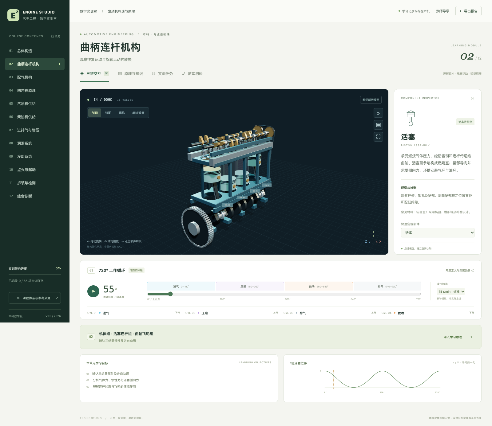

# ENGINE STUDIO · 发动机构造与原理实训

[在线预览](https://chatyu12.github.io/engine-studio-courseware/) · [课件使用说明](engine-lab/README.md) · [课程知识体系](engine-lab/docs/01-课程知识体系.md) · [迭代验收记录](engine-lab/docs/02-迭代与验收记录.md)

面向机械工程与车辆工程本科的交互式 HTML 课件。包含直列四缸 DOHC 三维模型、720°工作循环、两大机构与五大系统、拆装测量和形成性评价。

- 三维旋转、缩放、部件选择，装配 / 剖切 / 爆炸 / 单缸观察。
- 12个教学单元、38项实训任务、24道带解析的自测题。
- 排量、压缩比、功率与气缸磨损教学计算。
- 本机学习记录、Markdown报告与模型截图导出。
- 桌面与手机布局；单文件课件可下载后离线打开。



## 部署

GitHub Pages 从 `main` 分支根目录发布，入口为 `index.html`，`.nojekyll` 保持静态文件直接发布。

更新课件后，在仓库根目录运行：

```sh
npm --prefix engine-lab ci
npm --prefix engine-lab run check
(cd engine-lab && npm run build)
node scripts/prepare-pages.mjs
```

将生成的 `index.html` 与源码一并提交推送，Pages自动更新。

## 本地预览

```sh
python3 -m http.server 8765
```

打开 `http://localhost:8765/`，或直接在现代浏览器打开根目录 `index.html`。

## 教学边界

本模型是通用教学结构示意，非量产机型CAD或经认证的维修系统。气门采用理想启闭规则；真实配气相位、油水路、紧固扭矩、间隙和报废限值以对应机型手册为准。课程投用前需任课教师复审。用户学习数据仅在浏览器本机保存。

Three.js / OrbitControls 使用MIT许可证，许可文本保存在 `engine-lab/dist/vendor/THREE-LICENSE.txt`，也已嵌入单文件HTML。
